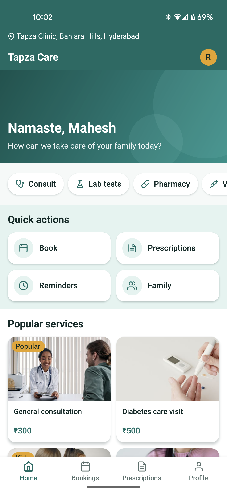
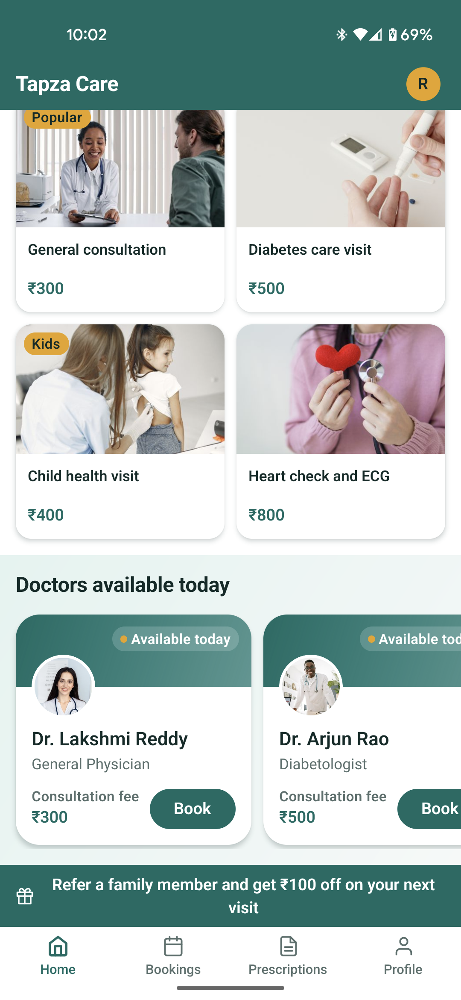
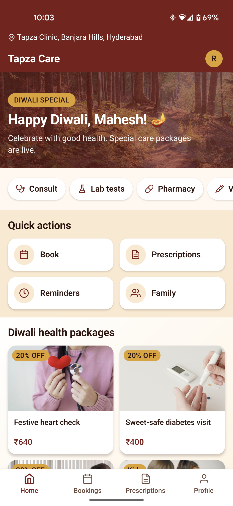
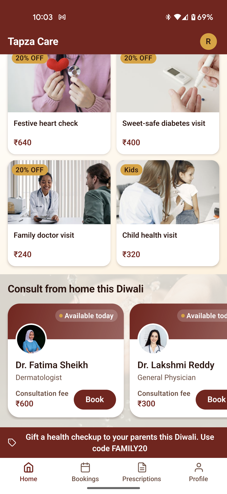
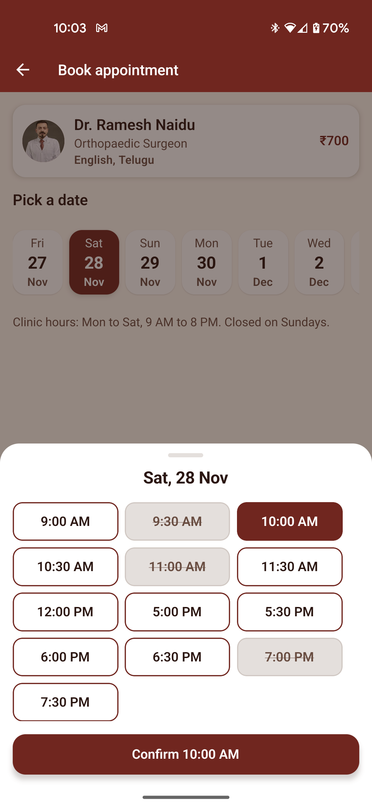
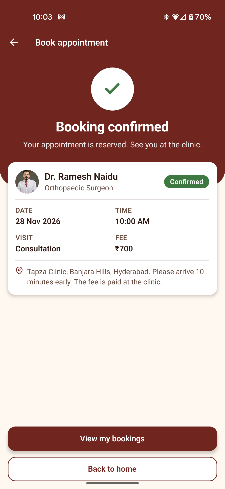
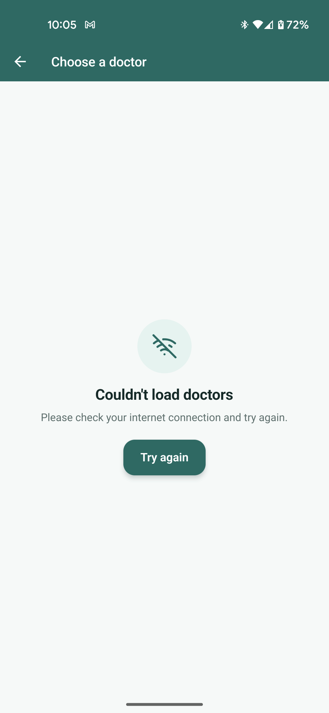
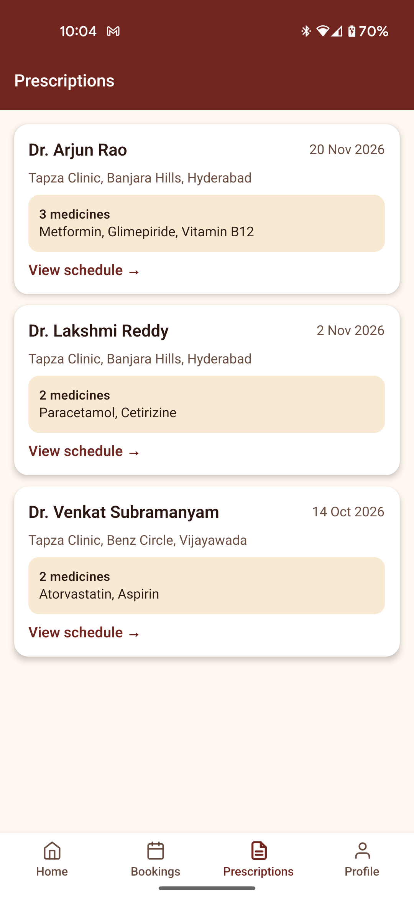
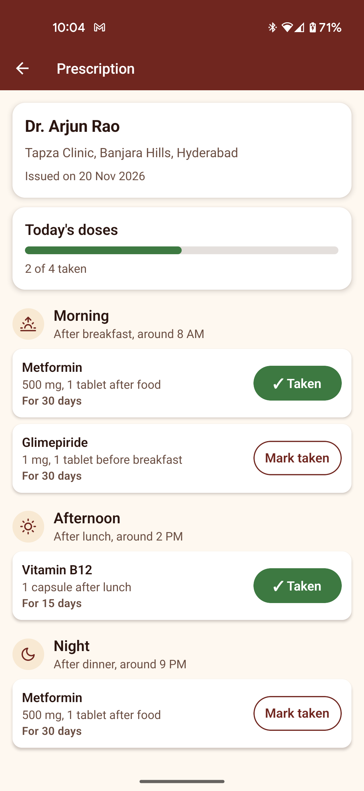
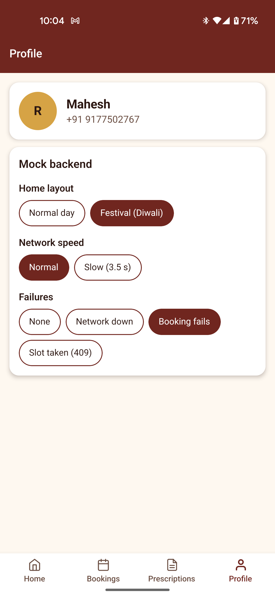

# Tapza Care – Patient App

Tapza Care is a patient mobile application for Tapza Clinic, serving Hyderabad and Vijayawada.

I built this application using React Native 0.88 and TypeScript (strict mode), with a primary focus on Android. The backend is currently mocked inside the app to demonstrate the complete user flow without depending on a live API.

## Features

- **Home Screen:** Dynamic home screen powered by remote configuration. Themes, colours, tabs, section order, banners, and content can all change without modifying the app code.
- **Multiple Configurations:** Supports normal and Diwali festival layouts, switchable from Profile > Mock backend.
- **Doctor Booking:** Patients can select a doctor or service, choose a date and time slot, and confirm appointments.
- **Optimistic Booking:** Shows the booking success screen immediately while the API processes the request. If booking fails, the app rolls back the change and displays an error.
- **My Bookings:** Displays appointments with Confirming and Confirmed statuses.
- **Prescriptions:** Patients can view prescriptions and mark medicines as taken for morning, afternoon, and night schedules.
- **UI States:** Includes loading skeletons, empty states, and error handling across screens.
- **Animations:** Includes a parallax hero banner, collapsing header, section fade-in effects, and a draggable booking bottom sheet.
- **Haptics:** Light vibration when a booking is confirmed and when a dose is marked as taken.

## Getting Started

### Requirements

- Node.js 22+
- JDK 17
- Android SDK
- Android device or emulator

### Installation

```sh
npm install
npm start
```

In another terminal:

```sh
npm run android
```

### Other commands

```sh
npm test
npm run lint
npx tsc --noEmit
```

### Generate APK

```sh
cd android
./gradlew assembleRelease
```

APK location:

`android/app/build/outputs/apk/release/app-release.apk`

### Install the APK

1. Open the **Releases** page of this repository on your Android phone and download `app-release.apk`.
2. If Android asks, allow installs from this source (Settings > Install unknown apps).
3. Open the downloaded file and tap **Install**.

The release build is signed with the default debug key, so it is only meant for testing.

## Mock Backend Testing

Go to **Profile > Mock backend** to test different scenarios.

| Setting       | Behaviour                                |
| ------------- | ---------------------------------------- |
| Home layout   | Switch between normal and Diwali layouts |
| Network speed | Normal (0.6s) or slow (3.5s) responses   |
| Network down  | Simulates API failures                   |
| Booking fails | Returns HTTP 500                         |
| Slot taken    | Returns HTTP 409                         |

## Project Structure

I organised the project by feature to keep related code together.

```text
src/
  api/              Mock API and backend
  config/           Remote config handling
  theme/            Theme and design tokens
  components/       Shared UI components
  features/
    home/           Home screen and sections
    booking/        Doctors and appointments
    prescriptions/  Prescriptions and medicine doses
    profile/        Profile and backend settings
  navigation/       App navigation
  hooks/            Reusable hooks
  types/            TypeScript models
  utils/            Common utilities
```

## Architecture Highlights

- **Remote Config:** Home screen content and theme are controlled by configuration.
- **Config Validation:** Invalid sections and items are safely skipped to avoid UI crashes.
- **Offline Fallback:** Uses network config first, then cached config, and finally the bundled default config.
- **Section Registry:** Uses a component registry to render different home screen sections.
- **State Management:** Uses React Context, a booking reducer, and a reusable `useRequest` hook.
- **Animations:** Uses React Native Animated API with the native driver and PanResponder.
- **Local Storage:** AsyncStorage maintains daily medicine dose status.
- **Accessibility:** Supports system font scaling, minimum touch targets, and automatic text contrast.

## Tests

There are a few tests for the parts that are easiest to break:

- `parseConfig` – bad sections, bad colours and unknown types.
- `SectionRenderer` – a known section renders and an unknown one renders nothing.
- `bookingsReducer` – optimistic add, confirm and rollback.
- `mockServer` – slots, the 409 conflict and the other endpoints.

Run them with `npm test`.

## Design Choices and Gaps

- **Doctor cards don't show a next available slot.** The brief lists it, but I left it off the home carousel to keep the cards clean. The card shows an "Available today" tag, and the real slots are on the booking screen.
- **Reminders are not notifications.** The Reminders tile opens Prescriptions, where doses can be marked as taken. There are no scheduled notifications.

## What I Left Out and Why

- **Local medicine reminder notifications:** needs native permissions and scheduling, and I preferred to finish the main flows properly.
- **Hindi and Telugu:** needs an i18n layer and translated content. Not enough time to do it well.
- **Dark mode and deep linking:** the theme already comes from the config, so dark mode is possible later. Deep links need extra navigation setup.
- **Offline booking queue and persistent bookings:** bookings are kept in memory only. A proper sync queue needs more edge cases than I could cover.
- **Admin screen and end-to-end tests (Detox / Maestro):** nice to have, not part of the core flows.
- **Lab tests, Pharmacy, Vaccines and Family:** the chips and tiles are there, but they only show a "coming soon" message.
- **Production release signing:** the APK uses the debug key.

## Screenshots and Demo

Demo video (about 3 minutes, recorded on a real Android phone): [docs/demo.mp4](docs/demo.mp4)

**Home – normal day and Diwali festival day**

<p>
  
  
  
  
</p>

**Booking**

<p>
  
  
  
</p>

**Prescriptions and mock backend switches**

<p>
  
  
  
</p>

## Time Spent

About 4 hours in total. Most of it went into the config-driven home screen and the booking flow, and the rest into prescriptions, the UI polish, tests and these docs.

## AI Usage

I used Cursor during development to speed up implementation and explore different approaches. I reviewed the generated code and made the final implementation decisions. The prompts and rejected approaches are documented in `AI_LOG.md`.
